# SurgWound Multi-Task Training Report

**Backbone:** tf_efficientnetv2_s

## Split: VAL

- **Exact Match Ratio:** 0.2619
- **Hamming Loss:** 0.1518

### Attribute: location
- Accuracy: 1.0000
- Macro (P/R/F1): 1.0000 / 1.0000 / 1.0000
- Weighted (P/R/F1): 1.0000 / 1.0000 / 1.0000
- ROC-AUC (Macro): nan
- Cohen's Kappa: nan
- ECE: 0.0000

| Class | Sensitivity (Recall) | Specificity |
|---|---|---|
| Abdomen | 0.0000 | 1.0000 |
| Patella | 0.0000 | 1.0000 |
| Ankle | 0.0000 | 1.0000 |
| Facial region | 0.0000 | 1.0000 |
| Manus | 0.0000 | 1.0000 |
| Cervical region | 0.0000 | 1.0000 |
| Other | 0.0000 | 1.0000 |
| Uncertain | 1.0000 | 0.0000 |

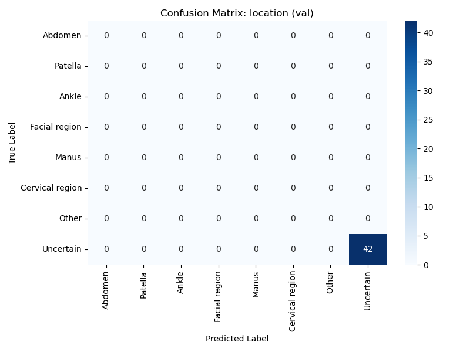

### Attribute: healing_status
- Accuracy: 0.7857
- Macro (P/R/F1): 0.7599 / 0.7500 / 0.7544
- Weighted (P/R/F1): 0.7825 / 0.7857 / 0.7836
- ROC-AUC (Macro): nan
- Cohen's Kappa: 0.5091
- ECE: 0.1885

| Class | Sensitivity (Recall) | Specificity |
|---|---|---|
| Healed | 0.8571 | 0.6429 |
| Not Healed | 0.6429 | 0.8571 |

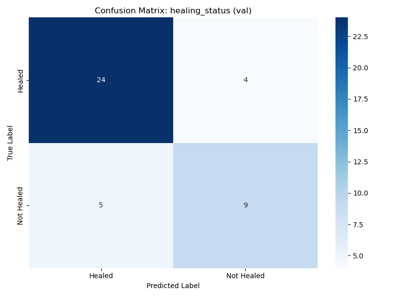

### Attribute: closure_method
- Accuracy: 0.8095
- Macro (P/R/F1): 0.7740 / 0.8167 / 0.7857
- Weighted (P/R/F1): 0.8379 / 0.8095 / 0.8163
- ROC-AUC (Macro): nan
- Cohen's Kappa: 0.5758
- ECE: 0.1833

| Class | Sensitivity (Recall) | Specificity |
|---|---|---|
| Invisible | 0.8333 | 0.8000 |
| Sutures | 0.8000 | 0.8333 |
| Staples | 0.0000 | 1.0000 |
| Adhesives | 0.0000 | 1.0000 |
| Uncertain | 0.0000 | 1.0000 |

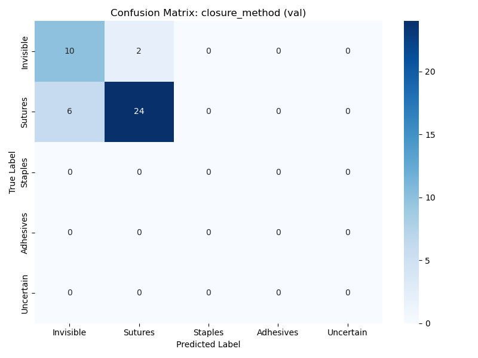

### Attribute: exudate_type
- Accuracy: 0.7857
- Macro (P/R/F1): 0.3829 / 0.2351 / 0.2753
- Weighted (P/R/F1): 0.8986 / 0.7857 / 0.8289
- ROC-AUC (Macro): nan
- Cohen's Kappa: 0.1189
- ECE: 0.1736

| Class | Sensitivity (Recall) | Specificity |
|---|---|---|
| Non-existent | 0.8421 | 0.2500 |
| Serous | 0.3333 | 1.0000 |
| Sanguineous | 0.0000 | 0.9512 |
| Purulent | 0.0000 | 0.9286 |
| Seropurulent | 0.0000 | 0.9762 |
| Uncertain | 0.0000 | 1.0000 |

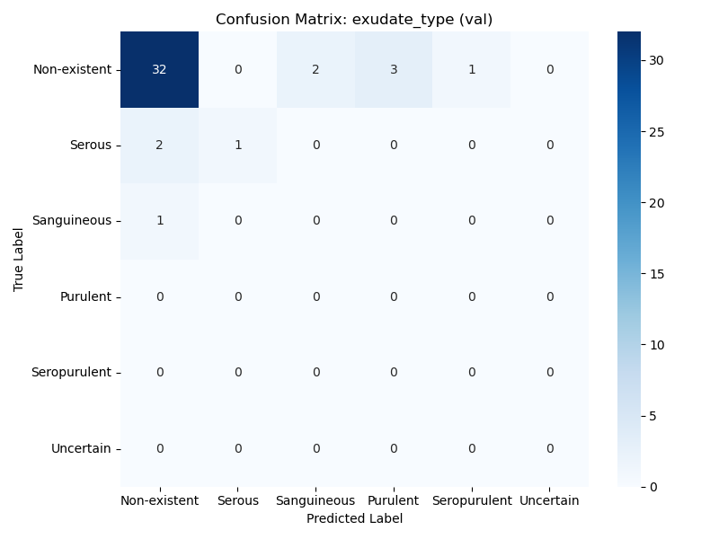

### Attribute: erythema
- Accuracy: 0.8095
- Macro (P/R/F1): 0.6912 / 0.6912 / 0.6912
- Weighted (P/R/F1): 0.8095 / 0.8095 / 0.8095
- ROC-AUC (Macro): nan
- Cohen's Kappa: 0.3824
- ECE: 0.0782

| Class | Sensitivity (Recall) | Specificity |
|---|---|---|
| Non-existent | 0.8824 | 0.5000 |
| Existent | 0.5000 | 0.8824 |
| Uncertain | 0.0000 | 1.0000 |

### Attribute: edema
- Accuracy: 0.7619
- Macro (P/R/F1): 0.5833 / 0.5662 / 0.5714
- Weighted (P/R/F1): 0.7381 / 0.7619 / 0.7483
- ROC-AUC (Macro): nan
- Cohen's Kappa: 0.1463
- ECE: 0.1680

| Class | Sensitivity (Recall) | Specificity |
|---|---|---|
| Non-existent | 0.8824 | 0.2500 |
| Existent | 0.2500 | 0.8824 |
| Uncertain | 0.0000 | 1.0000 |

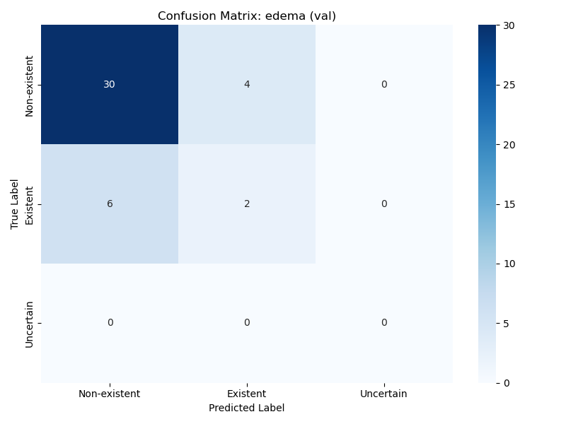

### Attribute: infection_risk
- Accuracy: 0.8333
- Macro (P/R/F1): 0.4804 / 0.4630 / 0.4714
- Weighted (P/R/F1): 0.8782 / 0.8333 / 0.8551
- ROC-AUC (Macro): nan
- Cohen's Kappa: 0.4167
- ECE: 0.1284

| Class | Sensitivity (Recall) | Specificity |
|---|---|---|
| Low | 0.8889 | 0.6667 |
| Medium | 0.5000 | 0.9167 |
| **(CRITICAL)** High | 0.0000 | 0.9524 |

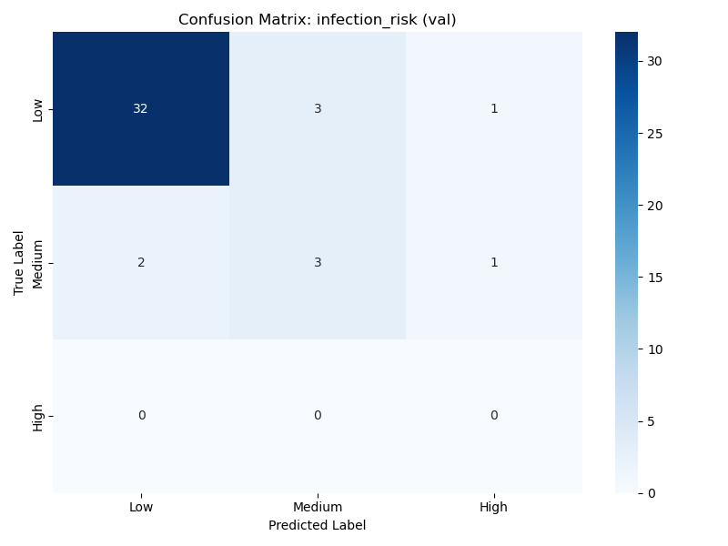

### Attribute: urgency_level
- Accuracy: 1.0000
- Macro (P/R/F1): 1.0000 / 1.0000 / 1.0000
- Weighted (P/R/F1): 1.0000 / 1.0000 / 1.0000
- ROC-AUC (Macro): nan
- Cohen's Kappa: nan
- ECE: 0.0000

| Class | Sensitivity (Recall) | Specificity |
|---|---|---|
| Home Care (Green) | 1.0000 | 0.0000 |
| Clinic Visit (Yellow) | 0.0000 | 1.0000 |
| **(CRITICAL)** Emergency Care (Red) | 0.0000 | 1.0000 |

**Mean Macro-F1 across 8 heads:** 0.6937

---

## Split: TEST

- **Exact Match Ratio:** 0.2381
- **Hamming Loss:** 0.1652

### Attribute: location
- Accuracy: 1.0000
- Macro (P/R/F1): 1.0000 / 1.0000 / 1.0000
- Weighted (P/R/F1): 1.0000 / 1.0000 / 1.0000
- ROC-AUC (Macro): nan
- Cohen's Kappa: nan
- ECE: 0.0000

| Class | Sensitivity (Recall) | Specificity |
|---|---|---|
| Abdomen | 0.0000 | 1.0000 |
| Patella | 0.0000 | 1.0000 |
| Ankle | 0.0000 | 1.0000 |
| Facial region | 0.0000 | 1.0000 |
| Manus | 0.0000 | 1.0000 |
| Cervical region | 0.0000 | 1.0000 |
| Other | 0.0000 | 1.0000 |
| Uncertain | 1.0000 | 0.0000 |

### Attribute: healing_status
- Accuracy: 0.8452
- Macro (P/R/F1): 0.8333 / 0.7924 / 0.8080
- Weighted (P/R/F1): 0.8424 / 0.8452 / 0.8402
- ROC-AUC (Macro): nan
- Cohen's Kappa: 0.6176
- ECE: 0.1351

| Class | Sensitivity (Recall) | Specificity |
|---|---|---|
| Healed | 0.9310 | 0.6538 |
| Not Healed | 0.6538 | 0.9310 |

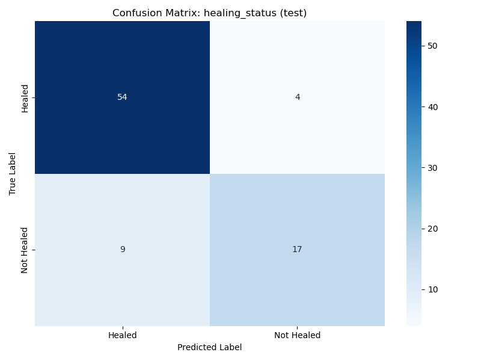

### Attribute: closure_method
- Accuracy: 0.5714
- Macro (P/R/F1): 0.2862 / 0.3375 / 0.2838
- Weighted (P/R/F1): 0.6566 / 0.5714 / 0.5824
- ROC-AUC (Macro): nan
- Cohen's Kappa: 0.2133
- ECE: 0.2278

| Class | Sensitivity (Recall) | Specificity |
|---|---|---|
| Invisible | 0.7500 | 0.6029 |
| Sutures | 0.6000 | 0.7083 |
| Staples | 0.0000 | 0.9877 |
| Adhesives | 0.0000 | 0.9873 |
| Uncertain | 0.0000 | 1.0000 |

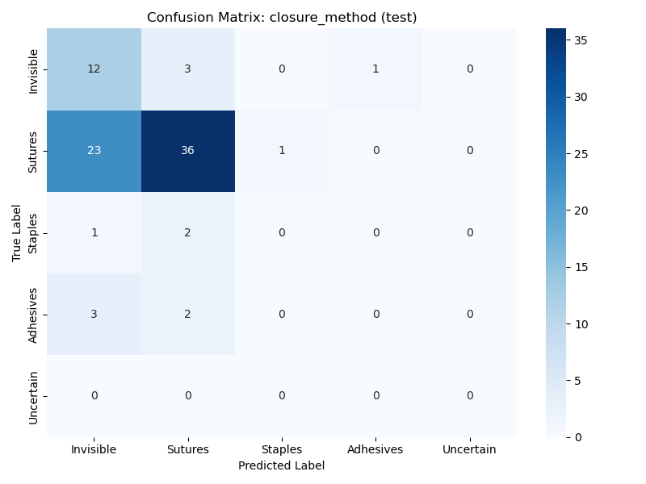

### Attribute: exudate_type
- Accuracy: 0.8452
- Macro (P/R/F1): 0.2200 / 0.2509 / 0.2299
- Weighted (P/R/F1): 0.8504 / 0.8452 / 0.8468
- ROC-AUC (Macro): nan
- Cohen's Kappa: 0.1826
- ECE: 0.0442

| Class | Sensitivity (Recall) | Specificity |
|---|---|---|
| Non-existent | 0.9211 | 0.3750 |
| Serous | 0.0000 | 0.9878 |
| Sanguineous | 0.0000 | 1.0000 |
| Purulent | 0.3333 | 0.9383 |
| Seropurulent | 0.0000 | 0.9762 |
| Uncertain | 0.0000 | 1.0000 |

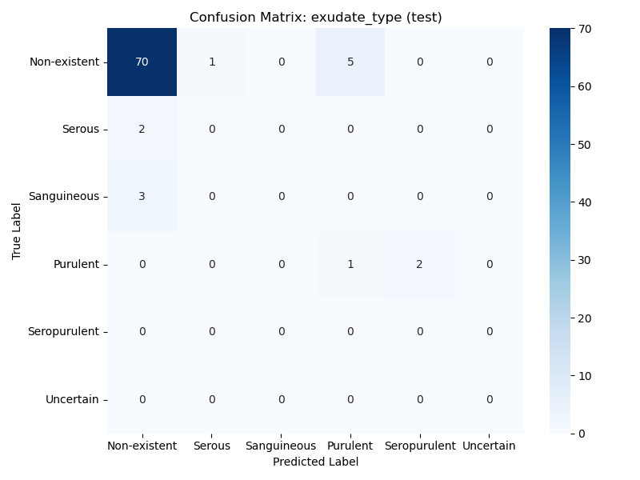

### Attribute: erythema
- Accuracy: 0.7857
- Macro (P/R/F1): 0.7170 / 0.7302 / 0.7229
- Weighted (P/R/F1): 0.7929 / 0.7857 / 0.7889
- ROC-AUC (Macro): nan
- Cohen's Kappa: 0.4462
- ECE: 0.1107

| Class | Sensitivity (Recall) | Specificity |
|---|---|---|
| Non-existent | 0.8413 | 0.6190 |
| Existent | 0.6190 | 0.8413 |
| Uncertain | 0.0000 | 1.0000 |

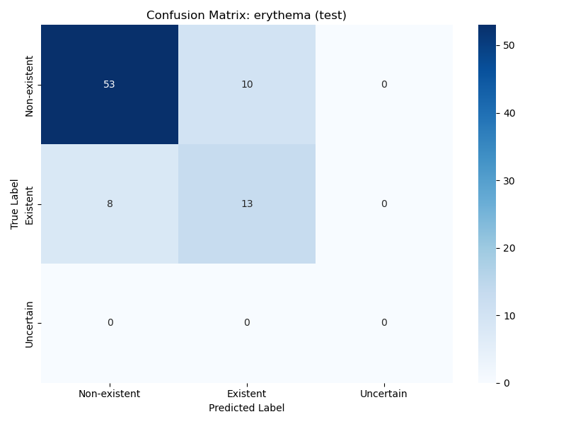

### Attribute: edema
- Accuracy: 0.8452
- Macro (P/R/F1): 0.6667 / 0.6793 / 0.6726
- Weighted (P/R/F1): 0.8512 / 0.8452 / 0.8481
- ROC-AUC (Macro): nan
- Cohen's Kappa: 0.3453
- ECE: 0.0915

| Class | Sensitivity (Recall) | Specificity |
|---|---|---|
| Non-existent | 0.9041 | 0.4545 |
| Existent | 0.4545 | 0.9041 |
| Uncertain | 0.0000 | 1.0000 |

### Attribute: infection_risk
- Accuracy: 0.7857
- Macro (P/R/F1): 0.4327 / 0.4484 / 0.4370
- Weighted (P/R/F1): 0.8338 / 0.7857 / 0.8070
- ROC-AUC (Macro): 0.8104
- Cohen's Kappa: 0.3268
- ECE: 0.1005

| Class | Sensitivity (Recall) | Specificity |
|---|---|---|
| Low | 0.8451 | 0.6154 |
| Medium | 0.5000 | 0.8611 |
| **(CRITICAL)** High | 0.0000 | 0.9639 |

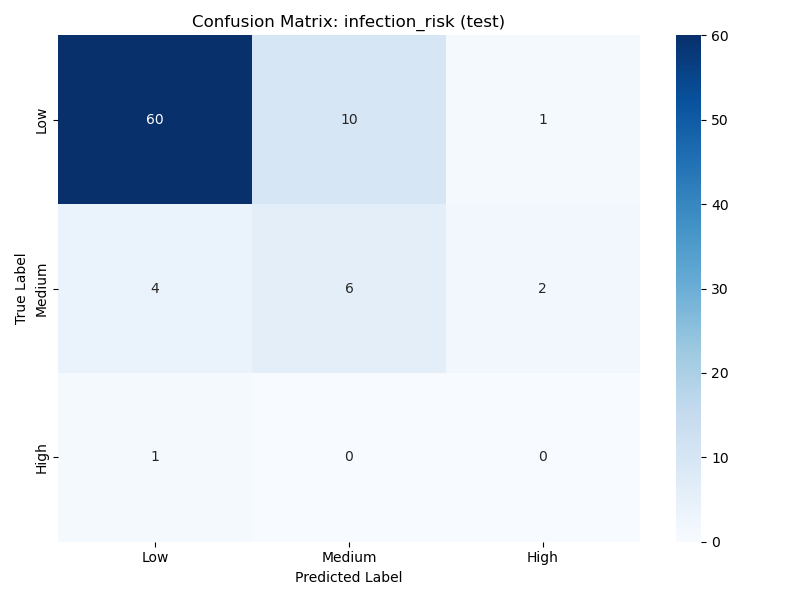

### Attribute: urgency_level
- Accuracy: 1.0000
- Macro (P/R/F1): 1.0000 / 1.0000 / 1.0000
- Weighted (P/R/F1): 1.0000 / 1.0000 / 1.0000
- ROC-AUC (Macro): nan
- Cohen's Kappa: nan
- ECE: 0.0000

| Class | Sensitivity (Recall) | Specificity |
|---|---|---|
| Home Care (Green) | 1.0000 | 0.0000 |
| Clinic Visit (Yellow) | 0.0000 | 1.0000 |
| **(CRITICAL)** Emergency Care (Red) | 0.0000 | 1.0000 |

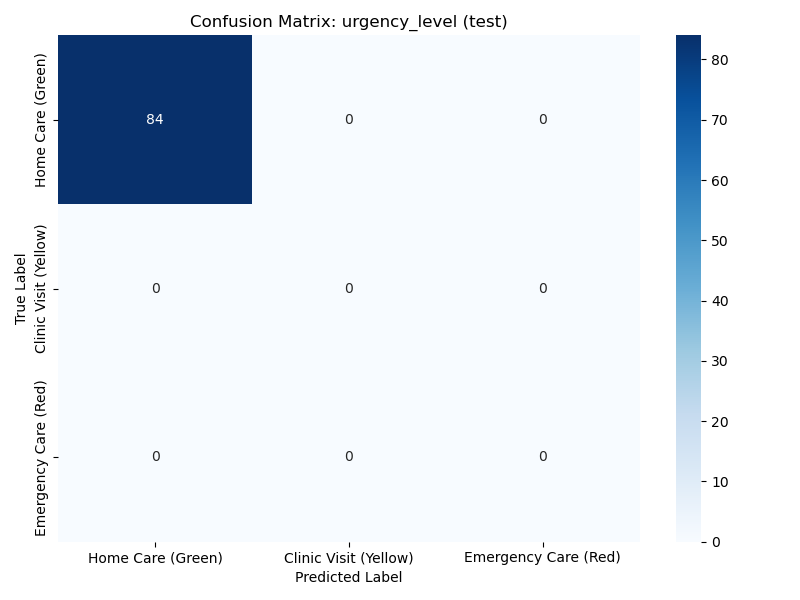

**Mean Macro-F1 across 8 heads:** 0.6443

---

