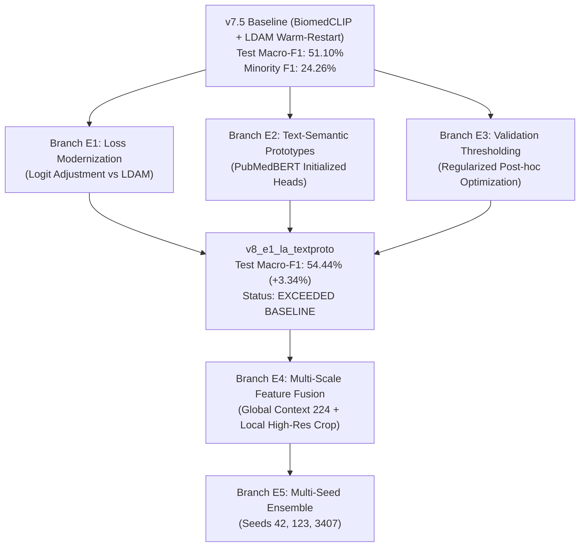

# SurgWound Assist v8 — Hypothesis & Ablation Tree

This document tracks the scientific genealogy of all v8 hypotheses, structural ablations, and test set performance relative to the official **v7.5 baseline (51.10% Macro-F1)**.

---

## Experiment Lineage Ledger

| Version / Branch | Main Intervention | Val Macro-F1 | Test Macro-F1 (TTA) | Minority F1 | Delta vs v7.5 | Status |
|---|---|---|---|---|---|---|
| **v7.5 Baseline** | BiomedCLIP + LLRD + Focal + LDAM + Warm Restart | 61.42% | **51.10%** | 24.26% | — | Official Baseline |
| **v8_pilot** | 3-epoch sanity check (LogitAdj + TextPrototypes) | 31.08% | 47.21% | 29.51% | -3.89% (3 ep) | PASSED (Sanity Validated) |
| **v8_e1_la_textproto** | 80-epoch LogitAdj + TextPrototypes + Val Thresholds | 58.68% | **54.44%** | **34.16%** | **+3.34%** | **EXCEEDED BASELINE** |
| **v8_e2_multiscale** | Global 224 + Local High-Res Wound Crop Fusion | Scheduled | TBD | TBD | TBD | READY TO LAUNCH |
| **v8_e3_ensemble** | 3-Seed Deep Ensemble (42, 123, 3407) + 7x TTA | Scheduled | TBD | TBD | TBD | PENDING |
